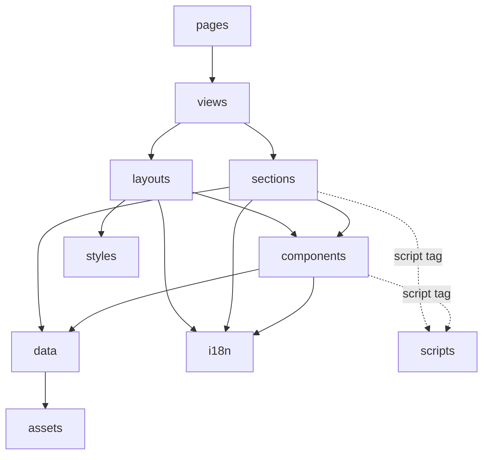
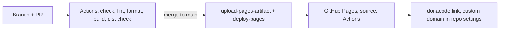

# Architecture Spine — Astro migration of donacode.link

## Design Paradigm

**Static-first islands.** Every page is prerendered HTML at build time. The browser receives zero JavaScript unless a page opts in with a small progressive-enhancement script; the page is complete and readable before any script runs.

| Layer | Directory | May import |
| --- | --- | --- |
| Routes (thin wrappers, one per URL) | `src/pages/`, `src/pages/es/` | `src/views/` |
| Views (one composition per page) | `src/views/` | layouts, sections, i18n |
| Layouts (document shell, `<head>`, chrome) | `src/layouts/` | components, i18n, styles |
| Sections (one per page block) | `src/sections/` | components, i18n, data, assets |
| Components (reusable UI) | `src/components/` | i18n, data, assets |
| Data (non-translatable content) | `src/data/` | assets |
| Copy and routes | `src/i18n/` | nothing |
| Scripts (client behavior) | `src/scripts/` | `src/scripts/`, npm packages |
| Tokens, motion and global CSS | `src/styles/` | nothing |



The import column is enforced by ESLint `no-restricted-imports` overrides per directory.

## Invariants & Rules

### AD-1 — Static output, no UI framework

- **Binds:** R1, R5, all pages
- **Prevents:** a React/Vue/Svelte island returning and breaking the JavaScript budget.
- **Rule:** `output: 'static'`, `site: 'https://donacode.link'`, default `base`. No `@astrojs/react|vue|svelte|preact|solid` integration. Client behavior is plain TypeScript in `src/scripts/`, loaded by a `<script>` tag in the section or component that needs it.

### AD-2 — Styles: scoped CSS plus a closed token vocabulary

- **Binds:** R2, R7, every `.astro` file
- **Prevents:** styling systems mixed across sections, token names and breakpoints invented per story.
- **Rule:** Styles live in the component's own `<style>` block and use `var(--…)` for every color, space, radius, shadow, font, z-index, width, duration and easing. `src/styles/tokens.css` is a closed vocabulary with the prefixes `--color-`, `--space-`, `--radius-`, `--shadow-`, `--font-` (families, `--font-size-*`, `--line-height-*`), `--layer-`, `--size-`, `--dur-`, `--ease-`. A token is added only as a row in the table in its header comment, in the PR that first uses it; a value equal to an existing token reuses it. Breakpoints are `640px`, `960px` and `1280px`, written literally in `@media (min-width: …)`; no other width appears in a media query. `src/styles/global.css` holds the reset, base element styles, print rules and the import of `motion.css`. No `style=""` attributes except a build-time value passed with `define:vars`; stagger order is a `data-index` attribute read in CSS. No Tailwind or CSS-in-JS.

### AD-3 — Copy: typed dictionary per locale

- **Binds:** R2, C4, every visible string
- **Prevents:** a string shown only in English, and copy scattered through markup.
- **Rule:** `src/i18n/en.ts` exports the dictionary `as const` and the `Dictionary` type derived from it; `src/i18n/es.ts` exports `satisfies Dictionary`, so a missing or extra key fails `astro check`. Keys are nested by section (`hero.title`). Sections and components receive `locale` and read copy through `t(locale)` from `src/i18n/index.ts`; a literal visible string in markup fails review. Alt text, `aria-label`, `<title>` and meta descriptions count as visible.

### AD-4 — Structured content

- **Binds:** R2, C4
- **Prevents:** two sections modelling lists differently (objects in the dictionary vs numbered keys), and HTML inside strings.
- **Rule:** Non-translatable data (URLs, dates, technology names, image imports, ordering, per-locale file paths such as the CV) lives in `src/data/<section>.ts`. The dictionary holds only translatable text. A list is an array in the dictionary with the same `id`s and order as its `src/data` array, joined by `id`; numbered keys (`caption1`) are forbidden. A link inside a sentence is split into `before`, `linkText` and `after` keys; never HTML in a string, never `set:html`.

### AD-5 — Locales, URLs and the routes module

- **Binds:** R3, R4, R11
- **Prevents:** two languages of a page diverging, URLs built by hand in different shapes, and the nav rendered twice.
- **Rule:** Astro i18n with `locales: ['en', 'es']`, `defaultLocale: 'en'`, `prefixDefaultLocale: false`, and `build.format: 'preserve'` (each page file builds to the same path: `es/index.astro` → `es/index.html`), so URLs are `/`, `/ecobike.html`, `/privacy.html` and `/es/`, `/es/ecobike.html`, `/es/privacy.html`. Each page's composition is `src/views/<Name>View.astro`; both `src/pages/x.astro` and `src/pages/es/x.astro` are wrappers that render it with `locale`. `src/i18n/routes.ts` is the only place that builds an internal URL: it exports `routes` (`home`, `ecobike`, `privacy`), `href(route, locale, hash?)` and `twin(pathname)`; templates never write `/es/` literally and do not use `getRelativeLocaleUrl`. The language switch is a plain `<a href={twin(...)}>`. Nothing is written to cookies, `localStorage` or `sessionStorage`.

### AD-6 — BaseLayout owns the document

- **Binds:** R3, R4, R5
- **Prevents:** two `<title>` tags, head tags built differently per page, chrome missing from one page.
- **Rule:** `src/layouts/BaseLayout.astro` takes `interface Props { locale: Locale; route: RouteKey | 'notFound'; ogImage?: string }`, reads title and description from `t(locale).meta[route]`, and is the only file that writes `<head>` content: `<html lang>`, self-canonical, `hreflang` for both locales plus `x-default` (the English URL), Open Graph tags with an absolute URL into `public/assets/`. It renders `Nav` and `Footer` once and is the only file that imports them. There is no head slot; a new head need is a new optional prop. Its single inline script (AD-7) is the only inline script in the site.

### AD-7 — Legacy `?lang=es` links and the `js` class

- **Binds:** R4, R8
- **Prevents:** old shared Spanish links landing on English pages (a static host cannot redirect by query), and content hidden when scripts fail.
- **Rule:** On English pages the inline `<head>` script calls `location.replace(href(route, 'es') + location.hash)` when `location.search` has `lang=es`. On every page it adds the class `js` to `<html>`. It does nothing else.

### AD-8 — One 404

- **Binds:** R2, R3
- **Prevents:** an `/es/404.html` GitHub Pages never serves, and a 404 indexed or listed in the sitemap.
- **Rule:** `src/pages/404.astro` is the only 404, bilingual in its HTML: two `lang`-attributed blocks, English shown by default; a module script in `src/scripts/` shows the Spanish block when the path starts with `/es/`. `BaseLayout` emits `noindex` and no canonical or `hreflang` when `route` is `notFound`.

### AD-9 — Motion

- **Binds:** R6, R7, R8, R5
- **Prevents:** animations that jank, ignore reduced motion or hide content when unsupported; duplicated keyframes; clashing view-transition names; a heavy library on every page.
- **Rule:** `src/styles/motion.css` holds everything cross-section: the `@view-transition { navigation: auto; }` at-rule, all `::view-transition-*` rules, shared `@keyframes` prefixed `mo-`, and the `[data-reveal]` rules. Every animation and transition anywhere is declared inside `@media (prefers-reduced-motion: no-preference)`; scroll-driven rules are also inside `@supports (animation-timeline: view())`. A section may apply `mo-` keyframes or define its own prefixed `local-`, never redefine an `mo-` name. `view-transition-name` values come only from the registry table in the header of `motion.css`. Page transitions are native cross-document View Transitions, not Astro's `ClientRouter`. From epic 2 on, only `transform`, `opacity` and `clip-path` are animated; epic 1 ports the current transitions exactly, including the nav's `max-width`, `border-radius`, `padding` and color changes, and epic 2 replaces them. GSAP is allowed only where CSS cannot express the effect, imported dynamically (`await import('gsap')`) by a script in `src/scripts/` after checking `matchMedia('(prefers-reduced-motion: no-preference)')`, and its bytes count toward the R5 budget of the page that loads it.

### AD-10 — Scripted state

- **Binds:** R7, R8, AD-9
- **Prevents:** a script and a CSS timeline fighting over one property, and content left hidden without JavaScript.
- **Rule:** A script changes the DOM only by setting `data-<feature>-state` (`data-nav-state="scrolled"`) on an element that carries the hook `data-<feature>`. Each feature has exactly one script file and one CSS owner; the epic that upgrades a feature replaces that owner and never adds a second mechanism on the same hook. Base CSS never hides content: a hidden initial state exists only inside the reduced-motion query and under either `@supports (animation-timeline: view())` or `html.js`. Content hidden by an interactive control the visitor operates (inactive tab panels, closed dialogs) is not a motion state: it may be hidden under `html.js` regardless of motion preference, and is fully shown without JavaScript and in print. Scripts write no inline styles and no style-bearing classes; a GSAP effect calls `clearProps` on cleanup. Scripts contain no visible strings and do not import `src/i18n`; a component renders the text a script needs into a `data-*` attribute, and scripts read the locale only from `document.documentElement.lang`. A motion change touches only motion rules and `data-` hooks, never markup structure or copy. Epic-1 exception: one scene script, `src/scripts/scenes.ts`, may write the scroll-progress custom properties `--p`, `--a`, `--b`, `--c`, `--lx`, `--ly` and `--ls` on `[data-scene]` elements, and nothing else, so the legacy scroll scenes keep exact parity in every browser; with reduced motion it writes their final values. Epic 2 replaces it with `animation-timeline` and deletes the script. Under the same exception, `src/scripts/tilt.ts` may write only `--tilt-x` and `--tilt-y` on `[data-tilt]` elements for the legacy hover tilt; epic 2 revisits it with the rest of the motion.

### AD-11 — Assets, third parties and privacy

- **Binds:** C1, C4, R5, R11
- **Prevents:** unoptimized images, layout shift, a request to another host, broken links to the CV or OG images, and a privacy page that stops being true.
- **Rule:** Images shown on pages live in `src/assets/` and render through `<Picture formats={['avif', 'webp']}>` with explicit `width`, `height` and `sizes`. Per page, only the first above-the-fold image is `loading="eager" fetchpriority="high"`; every other image is lazy. `public/` holds files served byte-for-byte at their current paths: `CNAME`, `robots.txt`, favicons, and `public/assets/` for the CV, the demo video and its poster, and the Open Graph images, so `/assets/cv-donato-ayala.pdf` and `/assets/og-image.jpg` keep working. Fonts are the system stack. Every script and style is bundled from npm or `src/`; no other host appears in the built HTML. Any change to what the site stores or requests updates the EN and ES text of the privacy page in the same PR.

### AD-12 — Build, check, deploy and rollback

- **Binds:** R5, R9, C2, C3
- **Prevents:** a change reaching donacode.link unchecked, builds differing between machines, and a cutover with no way back.
- **Rule:** npm with a committed `package-lock.json`; CI uses `npm ci` on the Node in `.nvmrc`. `.github/workflows/deploy.yml` runs on pull requests and on pushes to `main` with `permissions: contents: read, pages: write, id-token: write`. Every run executes `astro check`, `eslint .`, `prettier --check .`, `astro build`, then a script that fails if `dist/` lacks `index.html`, `ecobike.html`, `privacy.html`, `404.html` and the three `es/` twins, or if the home page ships more than 50 KB of gzipped JavaScript. Only a push to `main` deploys, via `withastro/action` and `actions/deploy-pages`. Cutover: the person switches the Pages source to GitHub Actions right before merging the first Astro PR. Rollback is a revert PR on `main`; until epic 1's last story removes the legacy `index.html` and `support.js`, switching the Pages source back to the `main` branch also restores the old site. Lighthouse runs by hand before an epic closes.

## Consistency Conventions

| Concern | Convention |
| --- | --- |
| Indentation and files | `.editorconfig`: 2 spaces, LF, UTF-8, final newline, trim trailing whitespace; Markdown keeps trailing whitespace. |
| Formatting | Prettier with `prettier-plugin-astro`: `printWidth: 100`, `singleQuote: true`, `semi: true`, `trailingComma: 'all'`. CI checks it. |
| Linting | ESLint flat config (`eslint.config.js`) with `eslint-plugin-astro` and `typescript-eslint` recommended rules plus the layer `no-restricted-imports`; no rule disabled without a comment saying why. |
| TypeScript | `tsconfig.json` extends `astro/tsconfigs/strict`; no `any`; props typed with `interface Props`. |
| Naming: files | Components, sections, views and layouts `PascalCase.astro` (`HeroSection.astro`, `HomeView.astro`); pages, scripts, data, styles and assets `kebab-case`. |
| Naming: code | Variables and functions `camelCase`; types `PascalCase`; i18n keys `camelCase` nested by section; `data-*` hooks `kebab-case`. |
| CSS classes | Scoped by Astro, so short semantic names (`.title`, `.media`); no BEM, no utility classes. |
| Accessibility | One `<h1>` per page; every image has alt text from the dictionary; focus styles never removed. |
| Branches and PRs | One branch per change, prefixed `feat/`, `fix/`, `content/`, `chore/`, `design/`; one PR each; the head branch is deleted on merge. |
| Project rules | When epic 1 lands, `AGENTS.md` replaces the x-dc runtime, `TX`/`L()` and inline-style rules with this spine's; the privacy-page duty in AD-11 stays. |

## Stack

| Name | Version |
| --- | --- |
| Astro | 7.4.4 |
| Node.js (CI and `.nvmrc`; `engines.node >=22.23.4`) | 26 |
| TypeScript | 6.0.3 |
| @astrojs/check | 0.9.12 |
| @astrojs/sitemap | 3.7.4 |
| sharp (Astro's image service) | 0.35.5 |
| GSAP (only where AD-9 allows) | 3.15.0 |
| Prettier | 3.9.10 |
| prettier-plugin-astro | 1.1.2 |
| ESLint | 10.13.0 |
| eslint-plugin-astro | 3.2.1 |
| typescript-eslint | 8.72.1 |
| actions/checkout | v7 |
| withastro/action | v6 |
| actions/upload-pages-artifact | v5 |
| actions/deploy-pages | v5 |

## Structural Seed

```text
portfolio/
  .github/workflows/deploy.yml   # PR: checks + build; main: + deploy
  public/
    CNAME  robots.txt  favicon.svg  favicon.ico  apple-touch-icon.png
    assets/                      # CV, demo video + poster, OG images (stable URLs)
  scripts/check-dist.mjs         # output paths + 50 KB JS budget (AD-12)
  src/
    assets/                      # images processed by astro:assets
    components/                  # Nav, Footer, LangSwitch, Button
    data/                        # non-translatable content per section
    i18n/                        # en.ts, es.ts, index.ts, routes.ts
    layouts/BaseLayout.astro     # the only <head>; chrome; the one inline script
    pages/                       # index, ecobike, privacy, 404 (thin wrappers)
      es/                        # index, ecobike, privacy (thin wrappers)
    scripts/                     # progressive-enhancement scripts
    sections/                    # one component per page block
    styles/                      # tokens.css, motion.css, global.css
    views/                       # HomeView, EcobikeView, PrivacyView
  .editorconfig  .nvmrc  .prettierrc.json
  astro.config.mjs  eslint.config.js  tsconfig.json
```

`astro.config.mjs` configures `@astrojs/sitemap` with `i18n: { defaultLocale: 'en', locales: { en: 'en', es: 'es' } }` and a `filter` that drops `404`; `robots.txt` points at `https://donacode.link/sitemap-index.xml`, and the old root `sitemap.xml` is removed.



Repository settings, done by a person, owned by epic 1: Pages source set to GitHub Actions with the custom domain `donacode.link` and HTTPS enforced; a branch ruleset on `main` requiring the CI check and a pull request; "Automatically delete head branches" on.

## Capability → Architecture Map

| Capability / Area | Lives in | Governed by |
| --- | --- | --- |
| R1 Prebuilt pages | `src/pages/`, `src/views/` | AD-1 |
| R2 Content parity | `src/sections/`, `src/i18n/`, `src/data/` | AD-2, AD-3, AD-4 |
| R3 `/es/` URLs, hreflang, sitemap | `src/pages/es/`, `BaseLayout`, `routes.ts`, sitemap config | AD-5, AD-6, AD-8 |
| R4 Legacy URLs | `build.format`, `BaseLayout` inline script, `public/assets/` | AD-5, AD-7, AD-11 |
| R5 Performance budget | whole build, `check-dist.mjs` | AD-1, AD-9, AD-11, AD-12 |
| R6 View Transitions | `src/styles/motion.css` | AD-9 |
| R7 Scroll-driven motion | `motion.css`, section styles, `src/scripts/` | AD-9, AD-10 |
| R8 Reduced motion | every animation | AD-7, AD-9, AD-10 |
| R9 Deploy | `.github/workflows/deploy.yml`, repo settings | AD-12 |
| R10 AGENTS.md | `AGENTS.md` | Conventions: Project rules |
| R11 No browser storage | `LangSwitch`, `BaseLayout`, privacy view | AD-5, AD-11 |
| C1 No third parties | build output | AD-11 |
| C2 PR only | branch ruleset, workflow | AD-12 |
| C3 GitHub Pages, same domain | repo settings, `public/CNAME` | AD-12 |
| C4 Spanish for every string | `src/i18n/` | AD-3 |

## Deferred

- Which effects use GSAP rather than CSS: decided per effect in epic 2; AD-9 and AD-10 fix how it loads, what it may write and what it costs.
- Exact token values: ported from the current site in epic 1's first section story; the vocabulary and breakpoints are fixed in AD-2.
- Browser tests (Playwright for parity and reduced motion): chosen when epic 1 is refined; the CI gate in AD-12 stands either way.
- A stylelint gate for AD-2's token rule: review-only until a violation slips through.
- Removal of `support.js` and the legacy `<x-dc>` files: epic 1's last story, after parity is verified; it also ends the branch-source rollback.
- TypeScript 7: when `@astrojs/check` and `typescript-eslint` declare support for it.
